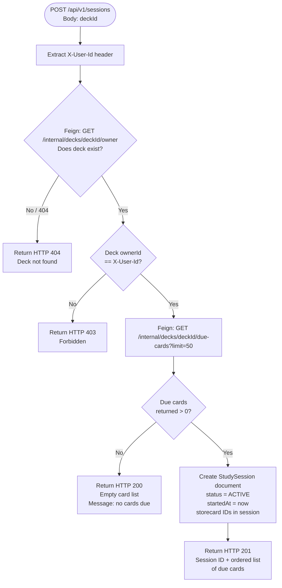
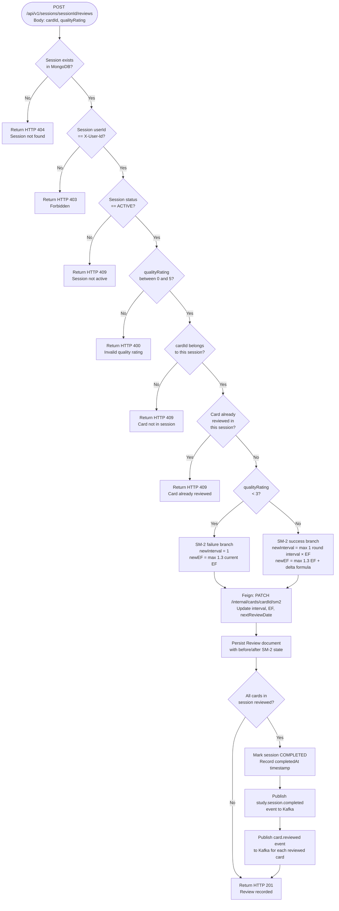
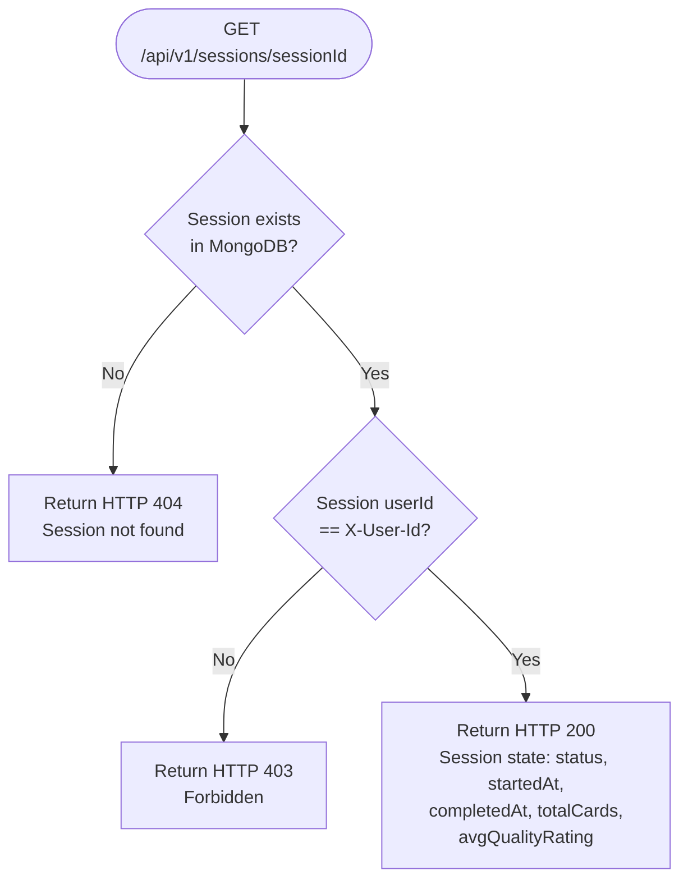
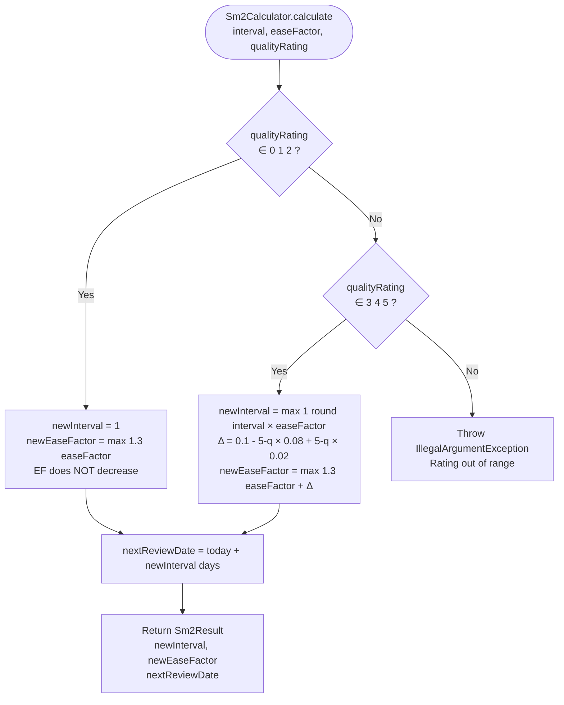
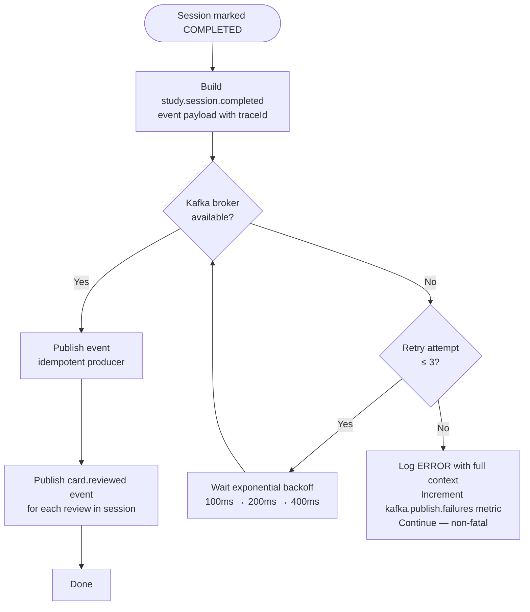

# Study Service — Flow Diagrams

---

## 1. Start Study Session

---

## 2. Submit Card Review

---

## 3. Get Session State

---

## 4. SM-2 Algorithm (internal decision logic)

---

## 5. Kafka Event Publishing (on session completion)

